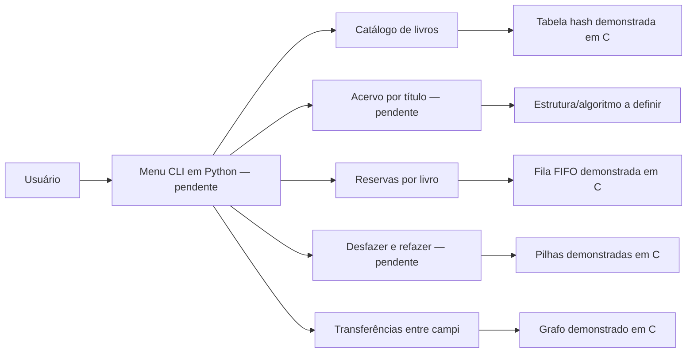

# 📚 Biblioteca — Estruturas de Dados

> Projeto acadêmico da 3ª avaliação de Estrutura de Dados. O sistema e os testes de desempenho podem ser feitos em Python; as implementações das estruturas avaliadas devem ser TADs em C (`.h` e `.c`).

---

## 📋 Sobre o Projeto

O objetivo é desenvolver um sistema para o cenário Biblioteca, cobrir as cinco demandas do enunciado e justificar as estruturas escolhidas com medições. A aplicação, a interface, a geração de dados e a lógica dos benchmarks podem ser escritas em Python. As estruturas de dados avaliadas devem ser implementadas pela equipe em C; não basta substituí-las por estruturas prontas do Python.

| Demanda | Necessidade | Estado atual |
|---|---|---|
| **D1 — Busca** | Encontrar um livro pelo código único. | Hash em C existe; há medição parcial, com chaves sequenciais. Busca Python também existe, mas não substitui o TAD C. |
| **D2 — Listagem** | Mostrar o acervo em ordem de título. | Pendente: não há listagem ordenada ou comparação implementada. |
| **D3 — Atendimento** | Atender a fila de reservas de um livro. | Fila em C existe; fila de reservas também foi prototipada em Python. A integração com empréstimos e devoluções e a medição da fila estão pendentes. |
| **D4 — Desfazer** | Desfazer/refazer o último empréstimo ou devolução. | Pilha em C e Python existe; faltam histórico e operações desfazer/refazer integrados ao estoque. |
| **D5 — Relação** | Encontrar campi alcançáveis em até duas transferências. | Representação do grafo em C existe; busca limitada a dois passos e integração estão pendentes. |

O repositório tem código Python em `sistema/` e TADs em C em `estruturas_c_projeto_teste/`. As duas partes são demonstrações independentes; não é necessário conectar a aplicação Python às estruturas C. O `main.c` da raiz é apenas um programa mínimo; o `main.c` dentro da pasta C contém medições parciais.

---

## 🏗️ Arquitetura e Modelo de Dados



O modelo Python inicial `Livro` contém código (`id`), título (`nome`), valor, estoque e indicador `emprestado`. Ao integrar as operações, definir se estoque representa exemplares totais ou disponíveis; um booleano não é suficiente para representar empréstimos quando há múltiplos exemplares.

---

## 📁 Estrutura do Projeto

```text
3-Avaliacao-Estruturas-de-Dados/
├── sistema/                         # aplicação/protótipo Python
│   ├── livro.py                     # modelo Livro
│   ├── funcoes.py                   # buscas, fila e grafo prototipados
│   └── estruturas.py                # pilha e grafo genéricos em Python
├── estruturas_c_projeto_teste/      # TADs e benchmark parcial em C
│   ├── *.h                          # interfaces dos TADs
│   ├── *.c                          # implementações
│   ├── main.c                       # benchmark parcial em C
│   └── Makefile
├── main.c                           # programa C mínimo (Hello World)
├── README.md
└── LICENSE
```

Os TADs C existentes incluem vetor, lista simples, lista dupla, lista circular, pilha, fila, deque, hash, árvore binária de busca, heap e grafo. A aplicação em Python e os exemplos dos TADs C são executados separadamente; não há requisito de integração entre eles.

---

## 🧩 Estruturas e Decisões

| Demanda | Escolha a implementar/defender em C | Alternativa para comparar | Pendência principal |
|---|---|---|---|
| **D1** | Tabela hash implementada em C como TAD demonstrável. | Busca sequencial em vetor. | Medir busca e inserção com dados aleatórios; incluir entradas ordenadas/quase ordenadas quando fizer sentido e discutir colisões. |
| **D2** | Escolher estrutura/algoritmo para listar por título; a lógica da aplicação pode ser Python. | Uma estratégia alternativa, indicando a linguagem usada. | Implementar listagem ordenada e comparar ordenar na consulta com manter ordenado. |
| **D3** | Fila FIFO encadeada implementada em C como TAD demonstrável. | Vetor/lista com remoção do primeiro elemento. | Demonstrar reservas por livro e medir enfileirar/atender. A ordem é de chegada. |
| **D4** | Pilha implementada em C como TAD demonstrável para desfazer/refazer. | Alternativa documentada, como cópia de estado. | Mostrar quais dados uma operação de empréstimo/devolução precisa registrar para restaurar o estoque. |
| **D5** | Grafo implementado em C como TAD demonstrável; a consulta também pode ser demonstrada separadamente em Python. | Matriz de adjacência. | Implementar busca em largura limitada a 2 arestas, definir direção e medir a representação escolhida. |

O `grafo.c` atual cria o grafo, adiciona arestas direcionadas e libera memória; ainda não implementa busca, valida índices ou evita arestas duplicadas. Definam se transferências funcionam nos dois sentidos; se sim, adicionem as duas arestas.

---

## ⚙️ Como Executar

Com `gcc` e `make` instalados, os TADs C existentes e o benchmark parcial podem ser compilados na pasta correspondente:

```bash
cd estruturas_c_projeto_teste
make
./projeto_ed
```

Esse executável demonstra os TADs e contém um benchmark parcial em C. A aplicação Python e os exemplos/benchmarks C são independentes; não há ponte entre as linguagens. O `main.c` da raiz é independente e imprime `Hello World!`.

O código Python não declara dependências externas, mas usa sintaxe de tipos genéricos do Python 3.12+. Para executar a aplicação final, ainda será necessário criar o ponto de entrada/menu e integrar os TADs C.

---

## 📊 Testes de Desempenho

O `main.c` em C já percorre `n = 100`, `1.000` e `10.000`, chama `srand(42)`, mede inserções e uma busca na hash e mede inserções/remoções no heap. Os experimentos da aplicação podem ser feitos em Python; os TADs C podem ser demonstrados e medidos separadamente em C. Deixem claro no relatório qual implementação cada medição avalia. A bateria atual é parcial: usa chaves sequenciais na hash, mede heap em vez da fila para D3 e não mede D2, D4 ou D5 nem compara alternativas.

O enunciado pede dados gerados pelo programa com semente fixa e pelo menos 10.000 registros no maior teste. Para cada demanda, comparar a estrutura escolhida com pelo menos uma alternativa em `n = 100`, `1.000` e `10.000`, com entradas aleatórias, ordenadas e quase ordenadas quando aplicável. Separar a preparação dos dados da operação cronometrada e registrar método, unidade, repetições e resultados no relatório de decisões.

---

## 🛠️ Tecnologias


C implementa as estruturas de dados avaliadas. Python pode implementar a aplicação, a geração de dados e os testes de desempenho. O Makefile usa `gcc` com C99 e avisos `-Wall -Wextra`.

---

## 📄 Entrega

O pacote final deve conter a aplicação (Python é permitido), os TADs das estruturas avaliadas em C, este README e o relatório de decisões com medições. A aplicação Python e os TADs C são entregáveis independentes e não precisam ser conectados. O enunciado exige cobrir D1 a D5, usar pelo menos quatro estruturas distintas (incluindo ao menos uma entre hash, ABB, heap e grafo), gerar dados com semente fixa e comparar alternativas nos tamanhos indicados.
